# MiniHFT - Low-Latency Trading Components in C++

[](https://github.com/veetihietasalo/MiniHFT/actions/workflows/build.yml)
[](LICENSE)
[](https://isocpp.org/)
[](.github/workflows/build.yml)

> An educational C++20 project that builds and measures some of the low-latency parts of a trading system: a lock-free SPSC queue, a NASDAQ ITCH 5.0 reader, and an order-by-order book that replays a full NASDAQ trading day. Not for production trading.

**Built for learning**: Lock-free concurrency, NASDAQ ITCH 5.0 parsing, market microstructure (order books built from order-level events), latency measurement, and software models of two hardware ideas (an FPGA-style pipeline and a NIC receive ring).

---

## 🎯 Why This Project?

Most of the project is systems programming for trading: concurrency, market data, order books and latency measurement. The quantitative part is small: an Avellaneda-Stoikov market maker, checked by rerunning the paper's simulation, and statistics and matrix templates.

- **For Recruiters**: A lock-free SPSC queue checked with ThreadSanitizer and on an ARM CI runner, where a deliberately broken copy with a relaxed publish damages messages; on x86 it compiles to the same instructions as the correct queue and damaged none in 10M. An ITCH 5.0 reader and an order-by-order book that replay a full NASDAQ day; latency reported as percentiles. Kernel bypass appears only as an in-memory model of a NIC receive ring.
- **For Learners**: Small pieces you can read and run on their own: the queue, the ITCH reader and two order books, the market maker, matrix and statistics templates, and software models of an FPGA pipeline and a NIC ring. Each has its own tests or program; they aren't wired into one system.
- **For Researchers**: The Avellaneda-Stoikov reservation price and approximate optimal spread, the paper's equations (29) and (30) (`include/Strategy.hpp`), unit-tested, and the paper's own simulation rerun with them ([results](#-avellaneda-stoikov-rerun)).

## 🏗️ Architecture

Three separate parts, each run by its own programs; none feeds another:

```mermaid
graph TB
    subgraph replay["Market data replay: itch_replay, itch_test (one thread)"]
        F["ITCH 5.0 file, or on Linux a gzip -dc pipe"] -->|length-prefixed messages| R["ItchReader: spans into its read buffer"]
        R -->|"itch::dispatch"| B["ItchBookBuilder: one L3 book per instrument"]
        B -->|top-of-book changes| L["Listener template parameter (a counter in the benchmarks)"]
    end
    subgraph queue["Queue benchmarks: ring_latency, ring_study"]
        P["Producer thread"] -->|"RingBuffer (lock-free SPSC)"| C["Consumer thread"]
    end
    subgraph sim["Market-making simulation: MiniHFT (src/main.cpp)"]
        M["Random-walk mid price"] --> MM["MarketMakerStrategy: Avellaneda-Stoikov quotes"]
        MM -->|"bid and ask"| X["Fills at rate A exp(-k delta)"]
        X -->|inventory| MM
    end

    style queue fill:#f9f,stroke:#333,stroke-width:2px
    style R fill:#bbf,stroke:#333,stroke-width:2px
    style MM fill:#bfb,stroke:#333,stroke-width:2px
```



ITCH data doesn't go through the queue, and the market maker runs only in its simulation, never on replayed market data.

## 🚀 Features

### Core Infrastructure
- ✅ **Lock-Free SPSC Ring Buffer** - one producer, one consumer. Slots are claimed and published in place, as in the LMAX Disruptor, each index has its own cache line, and each side caches the other's index. ~50 ns median one-way latency between pinned cores on one CCD, ~175 ns across CCDs
- ✅ **Thread Pinning** - pins each thread to one logical CPU (`SetThreadAffinityMask` / `pthread_setaffinity_np`). With `--high-priority` the ring benchmarks also raise both threads: `THREAD_PRIORITY_TIME_CRITICAL` on Windows (the top of the normal priority class), and the maximum `SCHED_FIFO` priority on Linux, which needs `CAP_SYS_NICE` and otherwise only prints a warning. The cores aren't isolated yet, so the OS can still preempt the spinning threads, and that sets the latency tail
- ✅ **Buffered ITCH Reader** - refills one reusable buffer (1 MiB by default) with `fread` and returns each message as a span into it: no per-message copy, and no allocation after construction unless a message is longer than the buffer, which can't happen at the default size. Fields are decoded at their spec offsets, not by casting to packed structs
- ✅ **Cache Optimization** - `alignas(64)` to prevent false sharing. With both sides' indices packed onto one cache line, back-to-back sends took 13.4 instead of 7.0 ns per message, and once one side did 20 ns of work per message they took 4-5 ns more inside a CCD and up to 22 ns more across CCDs ([measured](docs/ring_buffer_v2.md))

### Market Microstructure
- ✅ **Original Order Book** - the first book: each side a sorted `std::vector` of orders, and `match()` crosses the best bid and ask until they no longer overlap. Price priority only: a new order joins its price level ahead of older ones, and every trade prints at the ask. Kept as the baseline the L3 book is measured against
- ✅ **L3 Order Book** - Price levels with a FIFO per level and O(1) lookup by order reference; a full NASDAQ trading day replayed through it ([design and results](docs/order_book.md))
- ✅ **Strategy Hook** - A top-of-book listener passed as a template parameter and checked by a concept. GCC 13 inlines it (read from the -O3 assembly), and with no listener no notification code is generated. Once warm, ITCH dispatch into the L3 book builder makes no heap allocations, with no listener, a template one or a virtual one, and neither do `RingBuffer`, `ObjectPool::release` and `LatencyHistogram::record`; a counting `operator new` checks this in the MSVC and GCC CI jobs ([measurements](docs/zero_overhead.md))
- ✅ **NASDAQ ITCH 5.0 Parser** - Streams NASDAQ's length-prefixed files (whole days, from a file, or on Linux from a `gzip -dc` pipe) and decodes every order message type

### Quantitative Code
- ✅ **Avellaneda-Stoikov Market Maker** - quotes around the reservation price r = s − qγσ²(T−t) with the paper's approximate optimal spread γσ²(T−t) + (2/γ)ln(1 + γ/k), so inventory skews both quotes and the spread narrows toward the horizon. Unit-tested against values worked out by hand, and rerun in the paper's own simulation ([results](#-avellaneda-stoikov-rerun))
- ✅ **Statistics Helpers** - mean, sample variance and standard deviation, sample covariance, and a simple moving average over `std::vector`; floating-point only, which compile-fail tests check
- ✅ **`Matrix<T>`** - a dense row-major matrix template: bounds-checked access, transpose, and addition, subtraction and a naive triple-loop multiply, each of those three throwing on mismatched dimensions. Unit-tested

### Hardware Models
- ✅ **FPGA-Style Pipeline Sketch** - a C++ class with three register stages: `input()` latches a 32-bit word into the first, and each `tick()` updates the other two back to front, so each reads what its predecessor held before the clock edge: keep the low 16 bits, then zero the value unless it exceeds 100. Valid bits are never cleared, so it doesn't model bubbles; plain C++, not HDL
- ✅ **Kernel-Bypass RX Ring Model** - the receive-descriptor ring a poll-mode driver spins on, in plain memory: 1,024 descriptors, each handed between a simulated NIC thread and the polling thread by a release/acquire `ready` flag. Tested with two threads and under ThreadSanitizer; there is no real NIC or DMA

## 📊 Performance

### At a glance

On an AMD Ryzen 9 9900X3D: 12 cores on two 6-core dies (CCDs), each with its own L3 cache. p50 is the median, p99 the 99th percentile, and every latency includes about 10 ns of timer overhead.

| What | Result | Measured with |
|------|--------|---------------|
| One-way hop between two pinned threads, one message per µs (`RingBuffer`, same CCD) | **50 ns p50**, 71 ns p99 | `ring_latency`, MSVC, high priority, 12 cores |
| The same hop across CCDs | 171–180 ns p50, 320–331 ns p99 | the same, logical CPUs 4 → 16 |
| Queue throughput, back-to-back | **6.5–7.0 ns per message** (150 M msg/s), about 6× the original `fetch_add` queue | `ring_study` v2 row, MSVC, high priority, one CCD |
| Order-book update, order-by-order (L3) book | **20 ns p50** for a take or a make, flat from 10 to 1,000 resting orders per side. The original book's take grew from 131 to 1,005 ns | `orderbook_latency`, MSVC |
| A full NASDAQ day (30 Dec 2019) | **268.7 M messages** at 2.92–2.98 M msg/s, gzip decompression included; book update p50 131 ns, p99 495–502 ns; 0 events for unknown orders, 0 orders left at the close | `itch_replay`, GCC 13, WSL2 |
| Heap allocations once warm | **0** in `RingBuffer`, `ObjectPool::release`, `LatencyHistogram` and the ITCH → L3 book builder. The original `OrderBook` still allocates on every match | [`tests/zero_alloc_test.cpp`](tests/zero_alloc_test.cpp), in the MSVC and GCC CI jobs |
| Strategy hook (top-of-book listener) | 1–3.5 ns per event as a template; a virtual call adds another 1.3–2.3 ns | `orderbook_latency`, mean over 1M events, MSVC and GCC 13 |
| Memory ordering | A copy of the queue with `publish()` relaxed instead of release showed no damage on x86 (0 in 10M messages, 1,024 slots). On Arm Neoverse N2 it damaged messages in every run so far with an 8-slot ring, and only now and then with 1,024 slots. ThreadSanitizer reports the race on both. CI runs TSan on both and the 8-slot hardware check on ARM. | [memory_ordering.md](docs/memory_ordering.md#measured-on-arm) |
| Avellaneda-Stoikov market maker | The paper's own simulation rerun: inventory strategy profit 64.6, std 6.6 (paper 65.0, 6.6); symmetric 67.6, 13.2 (paper 68.4, 12.7) | `MiniHFT`, 1,000 runs each, GCC 13 ([details](#-avellaneda-stoikov-rerun)) |

Every latency here comes from that machine under Windows or WSL2. With 6 cores the OS preempts the spinning threads and sets the tail (the same hop's p99 is 0.9 µs there), and WSL2 adds VM effects: Hyper-V moves the virtual CPUs, and nested paging makes TLB misses costlier. Next is a native Linux baseline, at first without core isolation so it stays comparable ([setup](docs/native_linux.md)). The tables below have the details, and the linked docs the remaining caveats.

### Test machine

Measured on an AMD Ryzen 9 9900X3D, Windows 11 and WSL2. Unless a table says 12 cores, it ran with one CCD enabled and SMT off (6 cores). Timestamps come from the CPU's time-stamp counter, and percentiles from `LatencyHistogram` (at most 1.6 % bucket error). Every figure includes about 10 ns of timer overhead.

### Ring buffer: one-way latency between two pinned threads

`ring_latency`: one message every 1 µs from core 2 to core 3 (same CCD), 1,000,000 measured after 50,000 warm-up.

| Configuration | p50 | p90 | p99 | p99.9 | max |
|---------------|-----|-----|-----|-------|-----|
| Windows, MSVC, high priority | 50 ns | 70 ns | 0.9 µs | 222 µs | 500 µs |
| Windows, MSVC, normal priority | 70 ns | 80 ns | 140 µs | 530 µs | 1.06 ms |
| Linux (WSL2), GCC 13, normal priority | 71 ns | 113 ns | 103 µs | 313 µs | 534 µs |

- The hop itself is ~50–70 ns. The tail is set by the operating system: on a 6-core desktop the spinning threads get preempted. Across repeated runs, normal-priority medians ranged from 70 ns to 6 µs, and high-priority p99 from 0.9 to 16 µs. Isolated cores on native Linux (roadmap W03) should shrink the tail further.
- Measured from each message's *scheduled* send time rather than its actual send time, p99.9 reaches several milliseconds. One stall delays every message queued behind it, and measuring from the actual send hides that (coordinated omission).
- With back-to-back sends (`--interval-ns=0`) the median is 23–34 µs. That's queueing: each message waits behind up to 1,023 others.
- The table above was measured on the original queue. Since W03, `RingBuffer` uses release stores instead of `fetch_add` and caches the other side's index. Back-to-back throughput went from 38–39 to 6.5–7.0 ns per message (26 → 150 M msg/s), almost all of it from the release stores, and the paced median is ~50 ns. These are `ring_study`'s v2-variant figures. See [RingBuffer v2](docs/ring_buffer_v2.md) for each change measured on its own.

With both CCDs enabled (12 cores, SMT on), `RingBuffer` v2, MSVC and high priority. Each cell is the range over two runs:

| 12 cores | p50 | p90 | p99 | p99.9 | max |
|----------|-----|-----|-----|-------|-----|
| Same CCD (cores 4 → 6) | 50 ns | 61 ns | 71 ns | 0.85–1.0 µs | 17–20 µs |
| **Across CCDs** (cores 4 → 16) | **171–180 ns** | 262–291 ns | 320–331 ns | 1.7–1.9 µs | 19–81 µs |

- **Twice the cores cut the tail by two orders of magnitude.** The same high-priority run that had a p99 of 0.9 µs on 6 cores has one of 71 ns on 12, and p99.9 drops from 222 µs to under 1 µs. Windows now has idle cores to run its own work on. This compares against the original queue, but the median hop is the same 50 ns for both, so the queue change doesn't account for the tail.
- **Crossing CCDs adds about 125 ns per hop.** The cache line has to cross the I/O die. Keep a producer and its consumer on one CCD. What crossing does to each queue design is in [RingBuffer v2](docs/ring_buffer_v2.md#across-ccds).

### Order book: one update, original book vs L3 book

`orderbook_latency`: both books hold a fixed number of resting orders per side (the depth) and see the identical event sequence. A *take* removes the best resting order on one side: the original book adds an aggressive order and matches it, the L3 book receives an execution. A *make* restores the depth at a random level. MSVC, p50 in ns:

| Depth | take: original → L3 | make: original → L3 |
|------:|---------------------|---------------------|
| 10 | 131 → **20** | 20 → **20** |
| 100 | 191 → **20** | 50 → **20** |
| 1000 | 1,005 → **20** | 371 → **20** |

The original book keeps each side as a sorted `std::vector` of orders, so its cost grows linearly with depth: inserting at, or erasing from, the front shifts every order. The L3 book stays flat. Details: [docs/order_book.md](docs/order_book.md).

### A full NASDAQ trading day

`itch_replay` streamed NASDAQ's TotalView-ITCH 5.0 sample for 30 Dec 2019 through the L3 book: every symbol, every order event. GCC 13 under WSL2.

| | |
|---|---|
| Messages | 268,744,780 (8.25 GB uncompressed) |
| End to end, including decompression in a `gzip -dc` pipe | 2.92–2.98 M messages/s (90–92 s) |
| Book update per order message | p50 131 ns, p90 284–291 ns, p99 495–502 ns, p99.9 757–786 ns (mean 168–173 ns) |
| Peak live orders | 1,924,078 |
| Events for unknown orders, over-executions | 0, 0 |
| Live orders at the end of the day | 0: every order added was executed, deleted or replaced |

A real day costs about 6× more per update than the synthetic benchmark, which keeps one book and its orders in cache. The replay touches thousands of books and a 2-million-order working set.

### Reproduce

```bash
cmake --preset gcc-release && cmake --build --preset gcc-release
./build/gcc-release/ring_latency --high-priority   # SCHED_FIFO needs root on Linux
./build/gcc-release/orderbook_latency
gzip -dc 12302019.NASDAQ_ITCH50.gz | ./build/gcc-release/itch_replay -   # sample day from emi.nasdaq.com
```

On Windows the programs are in `build/msvc-release/Release/`. They print the CPU, compiler and core pinning with their results. `--help` lists the options.

Each harness takes `--json=FILE` for machine-readable results. `bench/compare.py` compares runs against a baseline and exits 1 on a regression. The CCD matrix saves a baseline with `--save-baseline` and checks a later build with `--check` ([how, and why only central metrics are gated](docs/verification.md#benchmark-baselines)).

`powershell -ExecutionPolicy Bypass -File bench\run_ccd_matrix.ps1` builds on Windows, then runs the ring and order-book benchmarks on a core pair inside each CCD and on a pair across CCDs. It reads the CCD layout and SMT state from Windows and writes everything to `build\bench-results\`. `bench/run_ccd_matrix.sh` does the same on Linux, and can also replay the gzipped NASDAQ day on each CCD. Only native Linux gives meaningful CCD numbers, not WSL2. [Benchmarking on native Ubuntu](docs/native_linux.md) covers the setup.

## 📈 Avellaneda-Stoikov, rerun

`MiniHFT` (`src/main.cpp`) reruns the simulation in section 3.3 of Avellaneda & Stoikov (2008) with `MarketMakerStrategy`: s = 100, T = 1, σ = 2, dt = 0.005, γ = 0.1, k = 1.5, A = 140. Each step the mid moves by ±σ√dt, and each quote is hit with probability A·e^(−kδ)·dt, where δ is its distance from the mid. The symmetric strategy quotes the inventory strategy's average spread around the mid instead of around the reservation price. 1,000 runs of each, GCC 13, seed 42, next to the paper's Table 1:

| Strategy | Average spread | Profit | Std(profit) | Final q | Std(final q) |
|----------|---------------:|-------:|------------:|--------:|-------------:|
| Inventory, this code | 1.49 | 64.6 | 6.6 | 0.08 | 3.0 |
| Inventory, paper | 1.49 | 65.0 | 6.6 | 0.08 | 2.9 |
| Symmetric, this code | 1.49 | 67.6 | 13.2 | −0.17 | 8.5 |
| Symmetric, paper | 1.49 | 68.4 | 12.7 | 0.26 | 8.4 |

- **The profits are about 2 standard errors below the paper's.** A 1,000-run mean profit has a standard error of about 0.2 for the inventory strategy and 0.4 for the symmetric one, and this run's means are 0.4 and 0.8 lower. The paper's means are just as noisy, so the gap is about 1.4 standard errors of the difference between the two. Over 20 seeds the means are 64.9 and 68.2.
- **Quoting around the reservation price halves the risk.** The profit's standard deviation drops from 13.2 to 6.6 and the final position stays near flat (std 3.0 against 8.5), for about 3 less mean profit. That trade is the point of the paper.
- `tests/strategy_test.cpp` checks the formulas against values worked out by hand from the paper's parameters, and `getQuotes`' rounding to the cent: the bid rounds down and the ask up, so the quotes are never tighter than the model's, except that a price within 10⁻¹¹ of a cent counts as on it (so binary error can't turn 0.57 into 0.56). The simulation itself quotes the unrounded prices.

## 🛠️ Build Instructions

### Prerequisites
- **Windows**: Visual Studio 2022 or newer, CMake 3.25+
- **Linux / WSL2**: CMake 3.25+ and Ninja, GCC 13+ for the `gcc-*` presets, and Clang 18+ with its sanitizer runtimes (`libclang-rt-18-dev` on Ubuntu) for the `clang-*` presets. Python 3 is optional; with it, ctest also runs `bench/compare.py`'s tests. x86-64 or AArch64: on ARM the timestamps come from the generic timer (`CNTVCT_EL0`) instead of the TSC
- GoogleTest and Google Benchmark are downloaded automatically on first configure

### Build and test
Each preset builds into `build/<preset>/`:

| Preset | Platform | Purpose |
|--------|----------|---------|
| `msvc-release` | Windows | Release build with MSVC |
| `gcc-release` | Linux | Release build with GCC |
| `gcc-debug-stl` | Linux | GCC with libstdc++ debug mode: checked iterators and containers |
| `clang-tsan` | Linux | Clang + ThreadSanitizer, for checking the lock-free code |
| `clang-asan-ubsan` | Linux | Clang + AddressSanitizer + UndefinedBehaviorSanitizer |
| `clang-fuzz` | Linux | libFuzzer target for the ITCH parser (`itch_fuzz`) |
| `clang-tidy` | Linux | Configure only: the compile database clang-tidy runs on |

Every preset treats warnings as errors. CI builds and tests the first five on each push, plus `gcc-release` and `clang-tsan` on an ARM64 runner, where the lock-free stress tests face real store reordering. It also fuzzes for 60 s, runs clang-tidy, and compares benchmarks against the merge-base (report only); see [Code Quality](docs/code_quality.md) and [Verification](docs/verification.md).

```bash
cmake --preset gcc-release          # configure (use msvc-release on Windows)
cmake --build --preset gcc-release  # build all programs, tests and benchmarks
ctest --preset gcc-release          # run the tests
```

On WSL, build from the Linux filesystem (e.g. `~/code/MiniHFT`) rather than `/mnt/c`: builds are much faster there. Keep the ITCH file there too, since `itch_replay`'s throughput includes reading it.

## 📝 Background notes

Notes from the start of the project, written before the measured work above. Parts are out of date; where they disagree with the code, the code and the design docs are right.

- [C++ notes](docs/cpp_learning_guide.md): templates, atomics, `alignas`, basic statistics and the Avellaneda-Stoikov formulas. It describes casting buffers to packed structs, which `ItchMessages.hpp` no longer does, and it uses the population variance where `Statistics.hpp` uses the sample variance.
- [Topic checklist](learning_roadmap.md): the topics the project set out to cover. Some, such as SIMD and PCA, have no code here.

## 📁 Project Structure

```
MiniHFT/
├── include/                  # Header-only libraries
│   ├── RingBuffer.hpp        # Lock-free SPSC queue
│   ├── Tsc.hpp               # Timestamps: TSC on x86, CNTVCT_EL0 on AArch64
│   ├── LatencyHistogram.hpp  # Log-linear latency histogram (at most ~1.6% bucket error)
│   ├── ThreadUtils.hpp       # Core pinning and thread priority (Windows, Linux)
│   ├── ItchMessages.hpp      # NASDAQ ITCH 5.0 message layouts, decode and encode
│   ├── ItchParser.hpp        # Streaming ITCH reader
│   ├── ItchBook.hpp          # Applies ITCH events to one L3 book per instrument
│   ├── L3OrderBook.hpp       # Order book built from order-level events
│   ├── OrderIndex.hpp        # Order reference -> order, open addressing
│   ├── ObjectPool.hpp        # Object pool: blocks of slots, released slots reused without allocating
│   ├── OrderBook.hpp         # Original book: a sorted vector per side, double prices; the L3 book's baseline
│   ├── Order.hpp             # Order and trade types
│   ├── Strategy.hpp          # Avellaneda-Stoikov market maker
│   ├── Statistics.hpp        # Mean, variance, covariance, moving average
│   ├── Matrix.hpp            # Template matrix class
│   ├── MarketSimulator.hpp   # Random order generator (no program uses it now)
│   ├── FpgaPipeline.hpp      # C++ sketch of a 3-stage register pipeline; no HDL
│   ├── KernelBypass.hpp      # In-process model of a NIC receive ring polled by the CPU
│   └── Network.hpp           # TCP client and server, Winsock only
├── src/                      # Small programs: MiniHFT (the Avellaneda-Stoikov simulation), gen_itch, itch_test, hw_bench, ring_bench, net_test (Windows)
├── bench/                    # Latency harnesses, Google Benchmark, compare.py, CCD scripts
├── tests/                    # GoogleTest, SPSC stress, compile-fail cases, ITCH fuzzer
├── cmake/                    # ctest wiring: compile-fail, SPSC stress, sanitizer smoke and compare.py tests
├── docs/                     # Design notes and measurements
└── .github/workflows/        # CI on x86 and ARM64: builds, tests, sanitizers, fuzzing, clang-tidy, benchmark comparison
```

## 🧪 Running Examples

### Market-making simulation
```bash
./build/gcc-release/MiniHFT   # one run of the inventory strategy, then 1,000 runs of each strategy
```

### ITCH Protocol Parsing
```bash
./build/gcc-release/gen_itch    # writes 20 ITCH 5.0 messages to market_data.itch in the current directory
./build/gcc-release/itch_test   # reads them back, prints each one and the resulting GOOGL order book
```

On Windows the programs are in `build\msvc-release\Release\` as `.exe` files; run both from the same directory.

### Performance Benchmarks
```bash
./build/gcc-release/ring_latency        # Ring buffer one-way latency percentiles
./build/gcc-release/orderbook_latency   # Original vs L3 order book, latency percentiles by depth
gzip -dc 12302019.NASDAQ_ITCH50.gz | ./build/gcc-release/itch_replay -   # NASDAQ ITCH day: throughput, latency, consistency checks
./build/gcc-release/ring_buffer_bench   # Google Benchmark: single-thread push + pop (gcc-release and msvc-release only)
```

## 📚 Key Concepts Demonstrated

### C++ Systems Programming
- **Atomics & Memory Ordering**: `std::memory_order_acquire/release`
- **Cache Line Alignment**: `alignas(64)` to prevent false sharing
- **Binary Decoding Without UB**: ITCH fields are read at their spec offsets with big-endian shift helpers and `memcpy`, not by `reinterpret_cast` over packed structs, so there is no alignment or aliasing UB. The reader returns `std::span`s into its read buffer, so it doesn't copy each message, and the ring buffer hands out pointers to its slots
- **Templates and Concepts**: Concepts for ITCH handlers and top-of-book listeners, and `static_assert`s on ring sizes and pool layout, each with a compile-fail test proving the misuse is refused. With no listener, `if constexpr` leaves the notification code out entirely, which the generated assembly confirms. Also a small `Matrix<T>` class template and statistics functions that accept floating-point types only

### Quantitative Finance
- **Market Making**: Avellaneda-Stoikov quotes: the paper's approximate optimal spread (its equations (29) and (30)) around its reservation price, rerun in the paper's own simulation (`src/main.cpp`)
- **Inventory Risk**: the reservation price r = s − qγσ²(T−t) moves both quotes against the position. In this rerun of the paper's simulation it halves the standard deviation of profit against quoting the inventory strategy's average spread around the mid (6.6 against 13.2; the paper has 6.6 against 12.7), for about 3 less mean profit
- **Statistics Helpers**: mean, sample variance, standard deviation, covariance and moving average, restricted to floating-point types and unit-tested. The simulation uses them for its summary; the strategy takes volatility as a fixed input

### Low-Latency Engineering
- **Thread Affinity**: `SetThreadAffinityMask` on Windows and `pthread_setaffinity_np` on Linux, with the core id range-checked first. A failed pin is reported, and `pinThread` is `[[nodiscard]]`, so ignoring its result fails the warnings-as-errors build (`ThreadUtils.hpp`)
- **Lock-Free Data Structures**: SPSC ring buffer
- **Binary Market Data**: NASDAQ ITCH 5.0 framing and decoding (big-endian fields, length-checked frames, fuzzed) from a file or a pipe. There is no network transport such as MoldUDP64 or multicast
- **Hardware Models**: `FpgaPipeline.hpp` is a C++ sketch of a register pipeline advanced by `tick()`, and `KernelBypass.hpp` models a NIC receive ring that the CPU polls, with a release/acquire hand-off per descriptor checked under ThreadSanitizer. Both run on the CPU; there is no FPGA, HDL or real NIC

## 🎯 Use Cases for Quant Roles

This project demonstrates skills relevant to:
- **Quant Developer**: C++ optimization, low-latency systems
- **Algo Trading Engineer**: Order-by-order (L3) book reconstruction over a full NASDAQ ITCH day (268.7M messages), with checks for unknown orders, over-executions and crossed books. Each of the 4,738 times an add or replace left a book crossed during market hours is traced to a halt, a limit-up/limit-down pause or a reopening auction
- **Quant Researcher**: The Avellaneda-Stoikov model implemented from the paper and checked against the paper's own simulation. There is no backtester or P&L on real data yet: no strategy runs on the replayed NASDAQ day
- **HFT Engineer**: Lock-free SPSC queues checked by ThreadSanitizer and on ARM hardware, binary feed decoding (ITCH 5.0), and latency measured as percentiles

## 📖 Documentation

- [Memory Ordering in RingBuffer](docs/memory_ordering.md) - Why each `memory_order` is there, ThreadSanitizer catching a broken copy, x86 vs ARM, and the broken copy failing on a Neoverse N2
- [RingBuffer v2](docs/ring_buffer_v2.md) - `fetch_add` → store, cached indices, false sharing and batching, each measured on its own
- [The L3 Order Book](docs/order_book.md) - Design, bugs fixed in the old code, old vs new, and a full NASDAQ day replayed
- [Zero-Overhead Extension Points](docs/zero_overhead.md) - Concepts for handlers and listeners, template vs virtual listener cost, the generated assembly, and zero-allocation tests
- [Code Quality](docs/code_quality.md) - Six bugs proven by failing tests and then fixed, hardened APIs, sanitizers, fuzzing, clang-tidy, and what CI checks
- [Verification](docs/verification.md) - A check for each area where AI-written C++ goes wrong: compile-fail tests for concepts and `static_assert`s, libstdc++ debug mode, stricter UBSan and the static analyzer, TSan on every threaded path except the Windows-only network test, SPSC stress under three schedules, and benchmark baselines with `compare.py`, which exits 1 on a regression (CI only reports), shown catching a 50 ns busy-wait planted in the order book's take path
- [Benchmarking on native Ubuntu](docs/native_linux.md) - Why WSL2 isn't enough for these benchmarks, and how to install, run, save a baseline and check against it on native Linux
- [C++ Learning Guide](docs/cpp_learning_guide.md) - An early primer on templates, atomics, alignment, ITCH and the Avellaneda-Stoikov formulas, written before the current code; see [Background notes](#-background-notes)

## 🤝 Contributing

This is an educational project. Contributions welcome:
- Additional quant models (Ornstein-Uhlenbeck, SABR)
- macOS support: `ThreadUtils.hpp` pins threads with `pthread_setaffinity_np` and `cpu_set_t` and reads the current core with `sched_getcpu`, none of which macOS has
- A POSIX port of `Network.hpp`, which is Winsock-only, so `net_test` builds only on Windows
- Performance optimizations
- Documentation improvements

## 📄 License

MIT License - see [LICENSE](LICENSE) file

## 🙏 Acknowledgments

**Concepts inspired by**:
- LMAX Disruptor Pattern
- Avellaneda & Stoikov (2008) - "High-frequency trading in a limit order book"
- NASDAQ TotalView-ITCH 5.0 Specification

---

**Author**: Built as a learning project for exploring HFT systems, C++, and quantitative finance.

**Status**: Educational/Research - Not for production trading
